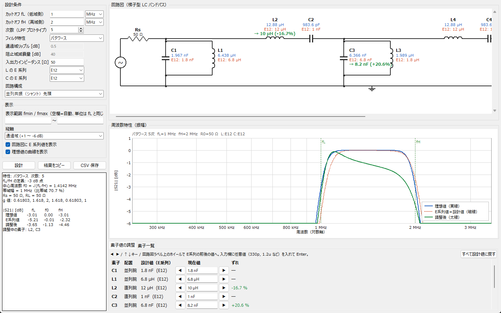
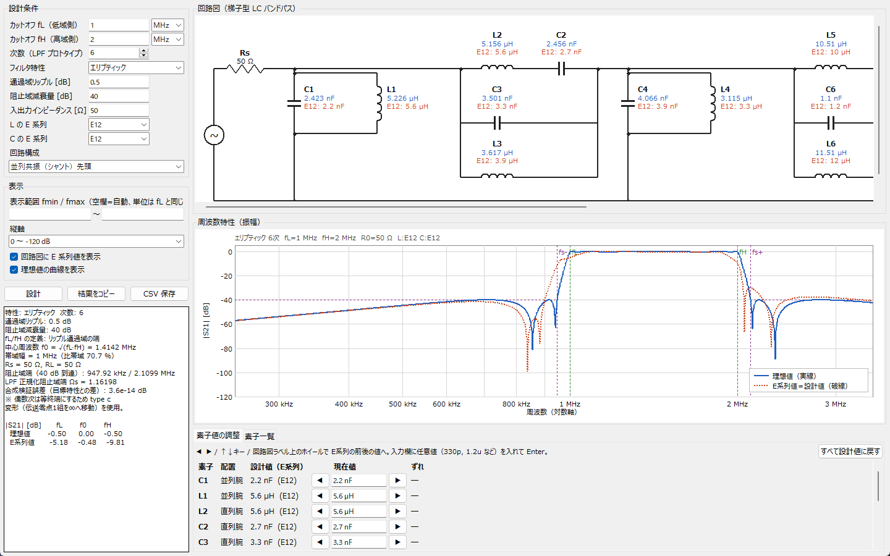

# LC BPF 設計ツール

LC 梯子型バンドパスフィルタ（BPF）を設計する Windows GUI アプリ。
Python 標準ライブラリ（tkinter）だけで動き、numpy などの外部パッケージは不要。

> 2026-11-26 に、同じ依頼（チケット #m0zkj7）で並行して作られた 2 つの版（D:\Codex_work 版と D:\claude 版）を統合したもの。D:\claude 版の履歴（素子値の調整機能の追加まで）は、このリポジトリの過去のコミットに残っている。

## 起動方法

- **exe 版（推奨）**: `dist\LC_BPF_Designer.exe` をダブルクリック。Python 不要の単体 exe で、どのフォルダにコピーしても動く（初回起動は展開のため数秒かかる）。未署名なので SmartScreen の警告が出る場合がある。
- `LC_BPF_Designer.bat` をダブルクリック（`pyw` → `pythonw` の順に探して起動。Python 3.8 以上が必要）
- `lc_bpf_designer.pyw` を直接ダブルクリック（.pyw が Python に関連付けられている場合）
- 動作確認用: `LC_BPF_Designer.exe --demo elliptic 5`（bat も同じ引数を受け付ける）で、その条件を設計した状態で起動する。`n=7 les=E24 first=series` のような `キー=値` 形式でも初期値を指定できる。

動作確認環境: Windows 11 Pro、Python 3.12.4 / 3.8.7（tkinter 8.6）

## 入力

| 項目 | 内容 |
|---|---|
| fL / fH | カットオフ周波数（単位 Hz/kHz/MHz/GHz、fL < fH を検査）。バタワースは −3 dB 点、チェビシェフ／エリプティックはリップル通過域の端 |
| 次数 | 低域プロトタイプの次数 1〜20 |
| フィルタ特性 | バタワース／チェビシェフ／エリプティック |
| L・C の E 系列 | それぞれ E6 / E12 / E24 / E96 から選択 |
| 入出力インピーダンス | 初期値 50 Ω |
| リップル | 初期値 0.5 dB（チェビシェフ・エリプティック、変更可） |
| 阻止域減衰量 | 初期値 40 dB（エリプティック、変更可） |
| 回路構成 | 並列共振（シャント）先頭／直列共振先頭 |

## 表示

- **回路図**: 梯子型の構成図。各素子に理想値（青）と E 系列値（赤）を表示。横スクロールは Shift+ホイール。
- **周波数特性**: |S21| [dB] を対数周波数軸で表示。理想値は実線、E 系列に丸めた値は破線で重ねる。fL/fH のマーカーを付け、エリプティックでは阻止域端 fs± と阻止域減衰量のガイド線も描く。マウス位置の値を読み取れる。表示範囲と縦軸レンジ（−120／−80／−40 dB、通過域拡大）を切り替えられる。
- **素子一覧**: 理想値、E 系列値、丸め誤差（%）。
- **設計情報**: f0、帯域幅、Rs/RL、g 値、阻止域端、fL/f0/fH での損失（理想値と E 系列値）。
- **出力**: 「結果をコピー」でクリップボードへ。「CSV 保存」で素子一覧を保存（UTF-8 BOM 付きなので Excel でそのまま開ける。調整値の列も含む）。



## 素子値の調整（設計後の微調整）

設計後、E 系列値（設計値）を素子ごとに変えて、周波数特性がどう変わるかを確かめられる。L・C のすべての素子が対象。

- 下部の「素子値の調整」タブに全素子が並ぶ。各行に素子名・配置・設計値・現在値・設計値からのずれ（%）を表示する。
- **ステップ変更**: ◀ / ▶ で、E 系列の前後の標準数に変える（L は「L の E 系列」、C は「C の E 系列」で選んだ系列）。入力欄で ↑ / ↓ キー、回路図の素子ラベル上でマウスホイールでも同じ操作ができる。
- **任意値の入力**: 入力欄に値を入れて Enter（例 `330p`、`330 pF`、`1.2u`、`1.2µH`、`4.7e-9`）。系列外の値からステップ変更すると、直近の標準数へ移る。
- 変更はすぐに特性へ反映される。グラフには、理想値（青の実線）・設計値＝E 系列（赤の破線）・調整後（緑の太線）を重ねて描く。「理想値の曲線を表示」のチェックを外すと青線を隠せる。マウスを乗せると、調整後の値と設計値との差（dB）も表示する。
- 回路図では、調整した素子に「→ 調整値 (ずれ%)」を緑で表示する。素子ラベルをクリックすると、調整パネルの該当行に移る。
- 設計情報に、調整後の fL/f0/fH での損失と、調整中の素子の一覧を表示する。
- 「すべて設計値に戻す」で全素子を E 系列の設計値に戻す。もう一度「設計」を押した場合も調整はリセットされる。
- 調整で変わるのは素子値だけで、負荷抵抗や fL/fH の表示は設計時のまま。

## 設計方法

1. 低域プロトタイプ（正規化、Rs = 1）
   - バタワース・チェビシェフ: g 値は閉形式で計算。
   - エリプティック: ヤコビの楕円関数（テータ関数による計算）で特性関数を作り、ダーリントン合成（有限伝送零点での部分極除去）で梯子回路を求める。高次で桁落ちしないよう、合成は 80 桁の decimal 演算で行う。偶数次は **type c** 変形（最低次の反射零点を DC へ、最高の伝送零点を ∞ へ移す）を使い、**入出力とも R0 の等終端**にする。
2. 先頭素子の切替（双対変換）
3. 帯域変換（f0 = √(fL·fH)、BW = fH − fL）: シャント C → 並列腕の並列共振器、直列 L → 直列腕の直列共振器。エリプティックの直列腕タンク（L∥C）は「直列 LC ∥ L ∥ C」の 4 素子枝になる（伝送零点を作るのに必要）。
4. E 系列への丸め（対数距離で最も近い値）と、ABCD 行列による |S21| の計算。



## 自己テスト

```
py -3.12 test_core.py
```

- 3 特性 × 1〜20 次 × 2 構成（1–2 MHz、50 Ω、0.5 dB、40 dB）で、帯域端の損失、通過域の最小値と最大値（0 dB を超えない）を検査する。エリプティックではさらに、阻止域減衰量、等終端、目標特性との合成誤差も検査する。
- エリプティックの厳しい組み合わせ（0.1/60、1/80、0.01/30、3/20、0.5/100 dB、狭帯域、75 Ω）を 1〜20 次で検査する。
- E 系列への丸めと、調整機能（E 系列のステップ移動、入力値の解釈、調整後の特性の再計算、リセット）を検査する。

GUI の動作確認（exe でも可）:

```
LC_BPF_Designer.exe --demo butterworth 5 --autocheck result.json
```

設計後、画面の操作ハンドラを経由して次を確かめ、結果を JSON に書いて終了する: 全 C を ▶ で 1 ステップずつ変えると特性・グラフ・一覧に反映されること、リセットで設計値に戻ること、↑ キー・◀・任意値入力・回路図上のホイールが効くこと。`--adjust C3=+1,L2=-1` を付けると、起動時にその調整を加えた状態で表示する。

## 既知の制限

- **偶数次チェビシェフ**は原理上、等終端にならない。RL は g(n+1) で決まり、0.5 dB の場合は並列共振先頭で R0×0.504、直列共振先頭で R0×1.98。画面と回路図に RL を表示する。
- エリプティックの 2 次は type c 変形で伝送零点がなくなり、単調な特性になる。偶数次の阻止域端は、同じ次数の標準（type a）よりわずかに外側になる（画面に表示）。
- 減衰量が小さく次数が非常に高い組み合わせ（例: 3 dB／20 dB で 16 次以上）は、遷移帯域が実質ゼロ（Ωs − 1 < 1e-8）になり合成できない。理由と対処を示すエラーを表示する。0.5 dB／40 dB では 1〜20 次のすべてで設計できる。
- 高次エリプティックは素子感度が非常に高い。E 系列に丸めると特性が大きく崩れるので、周波数特性で確認すること。
- 素子は理想素子（Q 無限大）として扱う。インダクタの Q、寄生成分、L の E96 品の入手性は考慮していない。
- 表示範囲を手入力するときの単位は fL と同じ。

## ファイル構成

- `lc_bpf_designer.pyw` — GUI（tkinter）
- `bpf_core.py` — 設計計算（プロトタイプ、エリプティック合成、帯域変換、E 系列、応答計算）
- `test_core.py` — 自己テスト
- `LC_BPF_Designer.bat` — 起動用
- `dist\LC_BPF_Designer.exe` — 単体 exe
- `LC_BPF_Designer.spec` — exe のビルド設定
- `screenshot_*.png` — README 用の画面

## exe の再ビルド

PyInstaller 6.22.3（Python 3.12.4、--onefile --windowed）でビルドしている。

```
pip install pyinstaller
pyinstaller --noconfirm --clean LC_BPF_Designer.spec
```
